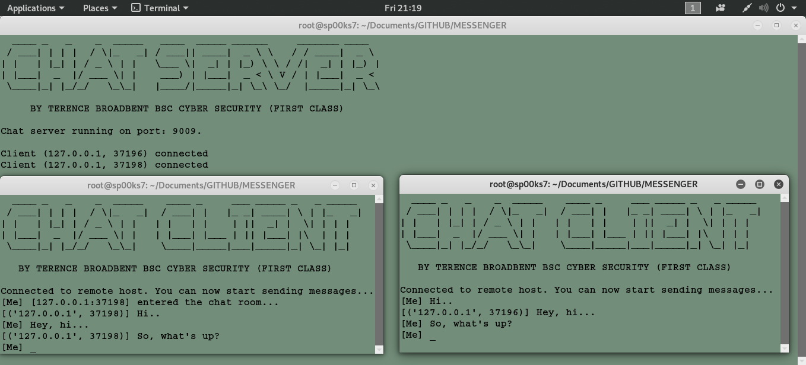

# MESSENGER

**Simple Python script files for a chatroom/messenger-style server and associated remote access client(s).**

<p align="center">
  
</p>

---

## USAGE

Start the server:

```bash
python server.py localhost 9009
```

Connect using the client:

```bash
python client.py localhost 9009
```

---

## FILES

| LANGUAGE | FILENAME | MD5 HASH |
|:---|:---|:---|
| Python | `server.py` | `22d0c51f495837198a721062efdc1c5a` |
| Python | `client.py` | `863caf1eefcfed4aff9e02627313f9c0 |

---

## ENCRYPTION

- [x] Add any of the following encryption functions to anonymize the datastream:

  - [BASE64-AES](https://github.com/BroadbentT/BASE64-AES)
  - [BASE64-BLOWFISH](https://github.com/BroadbentT/BASE64-BLOWFISH)
  - [BASE64-DNA](https://github.com/BroadbentT/BASE64-DNA)

A simple chatroom/messenger server with associated remote access client(s).

---

## CONSOLE DISPLAY


